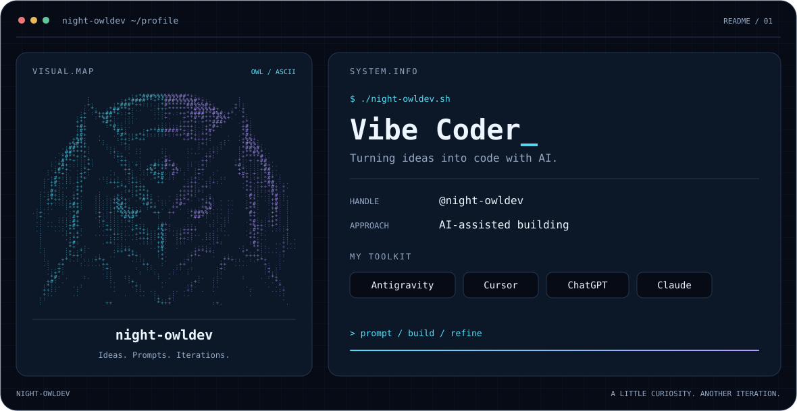

<picture>
  <source media="(prefers-color-scheme: dark)" srcset="./dark.svg">
  <source media="(prefers-color-scheme: light)" srcset="./light.svg">
  
</picture>

<b>Ideas into code. One iteration at a time.</b>

### Hey, I'm night-owldev 👋

I'm a **vibe coder** exploring what I can build with AI. My toolkit includes **Antigravity, Cursor, ChatGPT, and Claude**.

I like taking an idea, shaping it through prompts, and refining the result along the way.

### My toolkit

`Antigravity` · `Cursor` · `ChatGPT` · `Claude`

### Contribution trail 🐍

<picture>
  <source media="(prefers-color-scheme: dark)" srcset="https://raw.githubusercontent.com/night-owldev/night-owldev/output/github-snake-dark.svg">
  <source media="(prefers-color-scheme: light)" srcset="https://raw.githubusercontent.com/night-owldev/night-owldev/output/github-snake.svg">
  
</picture>

### Find me

[GitHub · @night-owldev](https://github.com/night-owldev)

<!-- Add selected projects here when ready. -->
